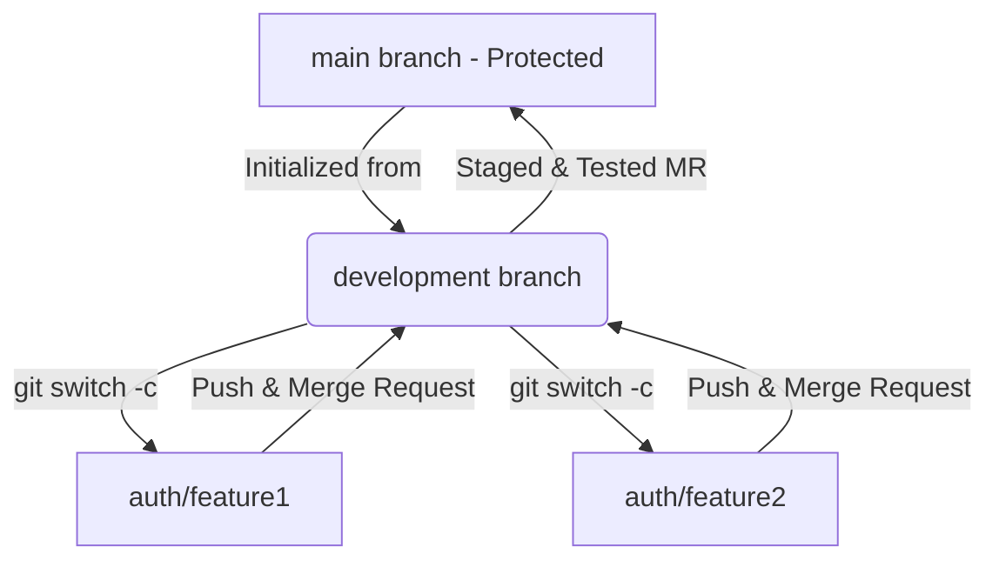

# Git Workflow Guidelines

This repository enforces a structured branching strategy to ensure code quality and stable deployments. Please follow these guidelines for all contributions.

---

## 🗺️ Repository Branches

*   **`main` (Protected)**: Production-ready code. Direct pushes are disabled. Code only enters `main` via approved Merge Requests (MRs) from `development`.
*   **`development`**: The integration branch for testing features. All features must merge here first.
*   **`auth/feature-name`**: Individual developer branches used to build specific authentication features.

---

## 🔄 Workflow Diagram



---

## 🛠️ Step-by-Step Developer Guide

### 1. Sync Your Local Repository
Before starting any new work, always ensure your local `development` branch is completely up to date.
```bash
git switch development
git pull origin development
```

### 2. Create Your Feature Branch
Create and switch to your designated feature branch using the `feature/` prefix naming convention.
```bash
# Example for feature 1
git switch -c feature/feature1

# Example for feature 2
git switch -c feature/feature2
```

### 3. Commit Your Work Locally
Make frequent, descriptive commits as you build your feature.
```bash
git add .
git commit -m "feat: add user login validation logic"
```

### 4. Push Your Branch to GitLab
When your feature is ready, push your individual branch to the remote GitLab repository.
```bash
git push -u origin feature/feature1
```
*(Note: The `-u` flag sets the upstream tracking branch for future pushes).*

### 5. Create a GitLab Merge Request (MR)
1. Go to your repository page on the GitLab website.
2. Click the **"Create Merge Request"** button next to your pushed branch.
3. Set the **Target Branch** to `development` (Do NOT target `main`).
4. Assign a reviewer and wait for approval.

---

## 🗑️ Post-Merge Cleanup
Once your Merge Request is approved and successfully merged into `development` on GitLab, clean up your workspace:

```bash
# Switch back to development and pull the newly merged changes
git switch development
git pull origin development

# Safely delete your local feature branch
git branch -d feature/feature1
```
